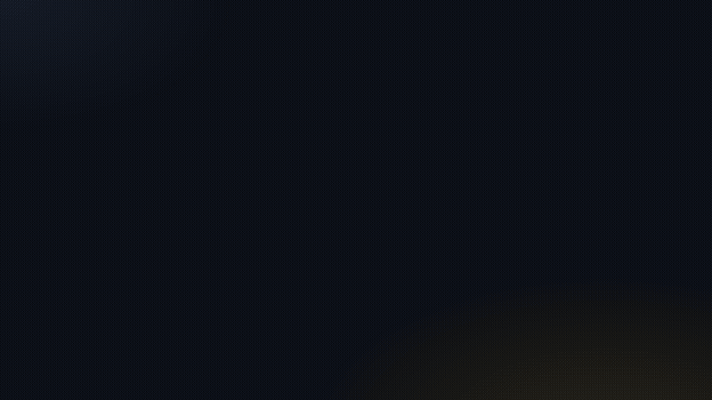

# Cineteca

**Your private cinema, on every screen in your home.**
Find, download and stream movies, series, anime and books. qBittorrent runs invisibly underneath.



▶ [Watch the full video (MP4)](docs/promo.mp4)

## Why Cineteca

1. **One search, no junk.** Curated Internet Archive collections. No trailers, no duplicates.
2. **Play in seconds.** Watch while it downloads, and resume where you stopped on any device.
3. **Every screen.** Scan a QR code on your phone; smart TVs find it automatically (DLNA).
4. **Plays any format.** MKV, AVI and HEVC 10-bit are converted on the fly.
5. **One folder, real delete.** Everything lives in `~/cripto`. Delete removes every file.

## Install

Requires **qBittorrent**, **ffmpeg** and **Node.js 20+**.

```bash
git clone https://github.com/RafaelCostaF/cineteca.git
cd cineteca && npm install && npm start
```

- **Linux menu entry:** `./scripts/install-linux.sh` (add `--autostart` to start at login)
- **Installer:** `npm run dist` builds AppImage/rpm/deb, dmg or exe
- **Headless server:** `npm run headless`

> **Fedora:** `ffmpeg-free` can't decode HEVC. Put a full ffmpeg build (e.g. [BtbN](https://github.com/BtbN/FFmpeg-Builds/releases))
> in `~/.local/bin`, or set `CINETECA_FFMPEG_DIR`.

## Other devices

Open the address shown in **Devices & Settings** (e.g. `http://192.168.1.22:8787`) on the same Wi-Fi.
Allow ports **8787/tcp** (app) and **1900/udp** (DLNA) in your firewall.

## License

MIT
